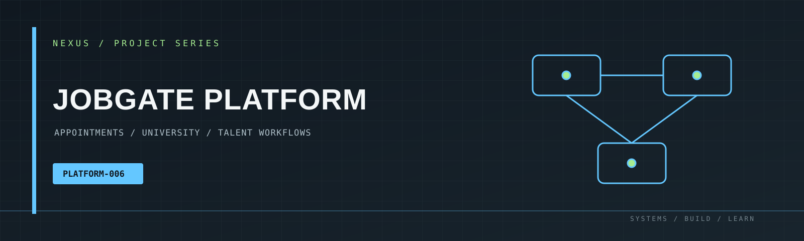

# JOBGATE — Appointment Management System

<div align="center">



</div>

A full-stack appointment management platform designed around interactions between university stakeholders and external talents or recruiters.

**Repository:** [HoussamEssaki/JOBGATE_Appointment_System](https://github.com/HoussamEssaki/JOBGATE_Appointment_System)

## Overview

JOBGATE brings together appointment scheduling, user roles, university-related information and supporting workflows in a web application. The project README and codebase describe a Django REST Framework backend and a React/TypeScript frontend.

## Main capabilities described by the project

- Role-oriented user experiences for administrators, university staff, talents and recruiters.
- Appointment creation, booking, cancellation and management.
- Calendar and availability-slot workflows.
- University profiles and staff-related information.
- Background task processing.
- Reporting and statistics.
- AI-service integration concepts.

Feature availability may vary by branch and configuration. Consult the implementation before treating every listed capability as production-ready.

## Technology stack

### Backend

| Technology | Role |
|---|---|
| Python | Backend language |
| Django | Web framework |
| Django REST Framework | REST API |
| PostgreSQL | Relational database |
| Redis | Cache / message broker |
| Celery | Background task processing |
| Docker Compose | Local service orchestration |
| CrewAI | AI-related service integration |

### Frontend

| Technology | Role |
|---|---|
| React | User interface |
| TypeScript | Typed application code |
| Vite | Development and build tooling |
| Material UI | UI component library |
| Zustand | Client-side state management |
| TanStack React Query | Server-state and data fetching |
| Axios | HTTP requests |

Versions and exact configuration should be taken from the dependency manifests in the repository.

## Architecture at a glance

```text
                  +---------------------------+
                  |     React / TypeScript    |
                  |       Vite frontend       |
                  +-------------+-------------+
                                |
                                | HTTP / REST
                                v
                  +---------------------------+
                  |   Django REST Framework   |
                  |       Backend API         |
                  +------+------+-------------+
                         |      |
                 +-------+      +----------------+
                 |                               |
                 v                               v
        +----------------+              +----------------+
        |  PostgreSQL    |              |     Redis      |
        |  Application   |              | Broker / Cache |
        |     data       |              +--------+-------+
        +----------------+                       |
                                                 v
                                        +----------------+
                                        | Celery workers |
                                        +----------------+
```

This is a conceptual view of the components named in the project documentation, not a deployment topology or guarantee that every service is enabled in every environment.

## Repository layout

The documented project is organized around:

- `backend/` — Django applications, API and service configuration.
- `frontend/` — React application, components, pages and client-side services.
- Docker Compose configuration and Python dependency manifests.

Check the current repository tree for the exact paths and filenames.

## Local development

### Prerequisites

- Git
- Python version supported by the backend dependency files
- Node.js version supported by the frontend package manifest
- Docker and Docker Compose, if using the containerized backend services

### Clone

```bash
git clone https://github.com/HoussamEssaki/JOBGATE_Appointment_System.git
cd JOBGATE_Appointment_System
```

### Configuration

Use the environment example files provided by the repository, if present. Keep credentials and secret keys in local environment files; never commit real secrets.

Before starting services, verify the current Compose file, environment variable names, exposed ports and frontend API URL. These values can change between project versions.

### Run

Follow the commands in the current backend and frontend manifests and configuration files. The exact commands are intentionally not duplicated here until the current tree and scripts have been verified.

## Security and configuration notes

- Do not use development credentials in a production environment.
- Keep Django secret keys, database passwords, JWT signing keys and API tokens out of version control.
- Disable debug mode in production.
- Restrict allowed hosts and configure trusted origins for the deployment environment.
- Review authentication, authorization and file-upload validation before deployment.
- Use HTTPS and review CORS, cookie and token-handling settings.

These are deployment review recommendations, not a claim that a production security assessment has been completed.

## Testing and quality

Use the test commands and scripts defined in the repository's current backend and frontend configuration. Add automated tests for authentication, role permissions, appointment lifecycle, API validation and critical frontend workflows.

## Current limitations of this documentation

This README provides an architectural and project overview. It does not certify that every feature, deployment workflow, test suite or external integration is complete or operational. Confirm these details against the current source code before deploying or extending the system.

## Future improvements

- Add real application screenshots and a short demonstration.
- Document API endpoints from the current implementation.
- Add an architecture diagram reflecting the actual deployment.
- Document reproducible development setup.
- Add CI checks for tests, linting and dependency security.
- Publish a clear list of implemented features and known limitations.

---

**Project:** JOBGATE Appointment Management System  
**Focus:** Full-stack development · REST APIs · Data management · Background processing
